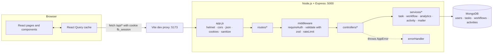
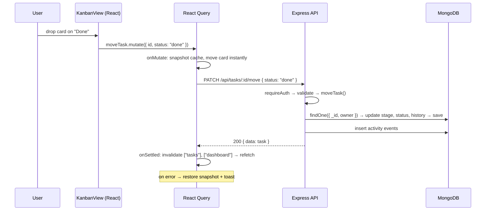
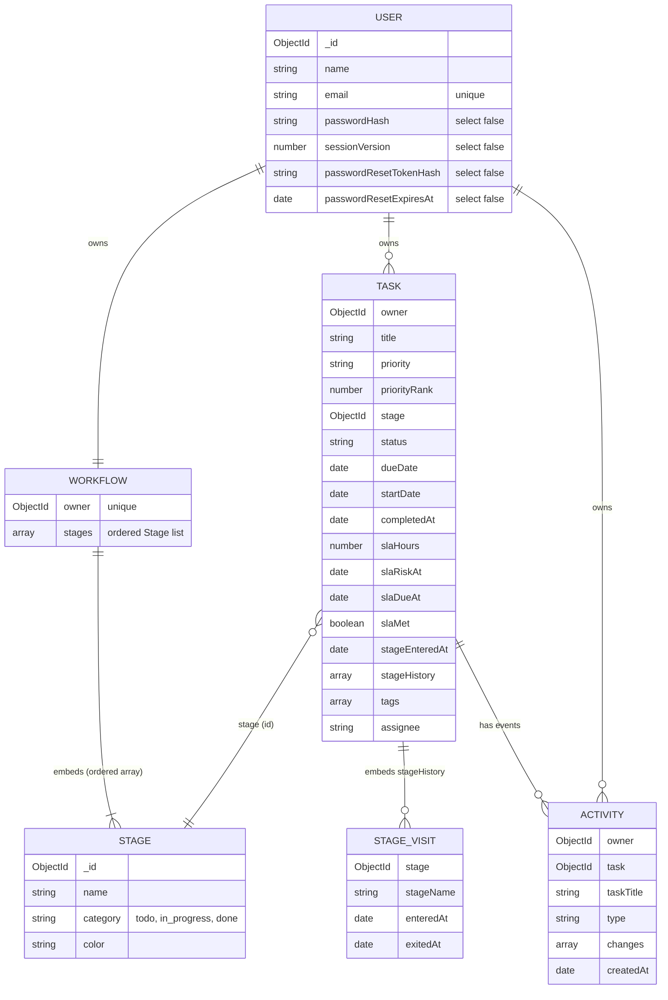

# Flowboard — MERN task management with workflows and SLAs

Flowboard is a full-stack task manager built with **MongoDB, Express, React and Node.js**. One set of tasks is shown three ways (a sortable **list**, a **Kanban** board and a customizable **pipeline**), every task can carry an **SLA target**, and the dashboard's analytics are computed from recorded stage transitions.

> Built as an interview project: the goal is code that is small enough to explain end to end, but structured the way a production app would be.

---

## Features

**Authentication & accounts**
- Register, login, logout; protected routes on the client and the server
- Passwords hashed with bcrypt (cost 12); JWT stored in an **HTTP-only, SameSite=Lax cookie**
- Forgot / reset password with a random token that is **hashed in the database, expires in 15 minutes and works once**; resetting signs out every existing session
- Local "dev mailbox" so the reset flow works without an email provider (see [Password reset in development](#password-reset-in-development))
- Rate limiting on login, register and reset endpoints; per-user data isolation on every query

**Tasks**
- Title, description, priority (low → urgent), workflow stage, start date, due date, estimate, SLA target, tags, assignee
- Create, edit, duplicate, mark complete, delete; bulk move / re-prioritise / delete in the list view
- Task detail drawer (deep-linkable via `?task=<id>`) with SLA meter, time spent in each stage and an activity timeline

**Three views, one source of truth**
- **List** – server-side pagination (10/20/50/100), sorting (created, due, priority, title, updated), bulk selection, inline stage/priority editing
- **Kanban** – columns are status categories (To Do / In Progress / Done); drag-and-drop with optimistic updates and rollback
- **Pipeline** – columns are your custom stages; add, rename, recolor, reorder and delete stages; per-stage stats under each column
- Search (debounced), priority/status/SLA/overdue/due-date filters, all kept in the URL so they survive view switches, refreshes and sharing

**SLA & analytics**
- SLA health: *on track*, *at risk* (≥ 75 % of the window used), *breached*, *met*
- **Overdue** (due date passed) is tracked separately from **SLA breach** (took longer than the SLA target)
- Dashboard: totals, overdue, due today, completion rate, 14-day created-vs-completed trend, SLA compliance, average completion time, average time per stage, upcoming deadlines, recent activity — all from MongoDB aggregations

**UX**
- Editorial, typography-led design (see [Design direction](#design-direction)); collapsible sidebar, mobile drawer, responsive layouts; skeleton loaders, empty/error states, toasts, confirmation dialogs
- Keyboard: `N` new task, `/` focus search, full keyboard drag-and-drop (Space to lift, arrows to move), focus-trapped dialogs, visible focus rings
- Public landing page; private pages are `noindex`

---

## Architecture



Request lifecycle for a drag on the Kanban board:



---

## Design direction

The interface is deliberately **not** the usual SaaS template (gradients, glass, a grid of identical stat cards). It's typography-led and flat, closer to an editorial page than a widget collection.

- **Type:** *Instrument Serif* for page titles and headline numbers, *Instrument Sans* for interface text, *IBM Plex Mono* for figures, dates and metadata. Hierarchy comes from size, face and spacing, not boxes.
- **Colour:** warm paper surfaces (`paper-*`), warm neutral ink (`ink-*`), and **one accent — persimmon** (`brand-*`) used only for focus, the active nav marker, urgency and key emphasis. Status uses three muted colours (good/warn/bad) and always comes with a word or a glyph, never colour alone.
- **Surfaces:** flat. Sections are separated by rules and whitespace; rounded containers and shadows are reserved for things that float (menus, dialogs, the drag overlay, the bulk-action bar).
- **Glyphs that carry meaning:** signal bars for priority (accent block for urgent), ring glyphs for status (dashed → half-filled → filled tick), a dot + word for SLA health.
- **Purpose-built views:**
  - *List*: a dense table with hairline rows, inline pickers that look like text but are native selects, and a floating bulk-action bar.
  - *Kanban*: lanes separated by rules, compact flat cards with a grip handle, and one line per column naming only what needs attention.
  - *Pipeline*: a progression strip whose segment widths show where work sits, numbered stage headers, and per-stage metrics in mono.
  - *Dashboard*: a one-sentence summary with linked numbers, one primary metric (SLA compliance) with its breakdown, a single throughput chart, a figures strip, then "Needs attention" and the activity timeline.
- **Motion:** quick fades and slides (≈200 ms, ease-out), no spring bounce, no decorative animation.

---

## Folder structure

```
flowboard-mern/
├── .env.example                # copy to server/.env
├── README.md · INTERVIEW_GUIDE.md
├── server/
│   ├── src/
│   │   ├── app.js              # Express app (exported for tests)
│   │   ├── server.js           # connect DB, listen, graceful shutdown
│   │   ├── config/             # env validation (zod), MongoDB connection
│   │   ├── models/             # User, Task, Workflow, Activity (+ indexes)
│   │   ├── validators/         # zod schemas per resource
│   │   ├── middleware/         # auth, validate, rate limit, sanitize, errors
│   │   ├── controllers/        # thin: read req.valid → call service → respond
│   │   ├── services/           # business logic (tasks, transitions, workflow, analytics, mailer)
│   │   ├── routes/             # URL → middleware → controller
│   │   └── utils/              # SLA maths, tokens, time helpers, AppError, response helpers
│   ├── scripts/seed.js         # idempotent demo data
│   └── tests/                  # node:test + supertest (39 tests)
└── client/
    ├── index.html              # meta, Open Graph, fonts
    ├── public/                 # favicon, robots.txt, og-image
    └── src/
        ├── main.jsx · App.jsx  # providers, lazy routes
        ├── components/ui/      # Button, Field, Dialog, Dropdown, Badge, Skeleton, ...
        ├── components/layout/  # AppShell (sidebar/topbar), PageHeader, Logo
        ├── features/auth/      # AuthProvider, route guards, auth layout, schemas
        ├── features/tasks/     # queries, filters, list/kanban views, board, card, form, drawer
        ├── features/workflows/ # pipeline view, stage dialogs, stage mutations
        ├── features/dashboard/ # charts (lazy-loaded Recharts)
        ├── pages/              # Landing, Login, Register, Forgot/Reset, Dashboard, Tasks, 404
        ├── hooks/              # useDebounce, useFocusTrap, useDocumentMeta, useLocalStorage
        ├── services/           # fetch wrapper + one function per endpoint
        └── utils/              # constants, formatting, cn()
```

---

## Technology choices

| Choice | Why |
|---|---|
| **Express 5** | Minimal, well known; v5 forwards errors from `async` handlers to the error middleware, so no try/catch wrappers. |
| **Mongoose 8** | Schemas, validation, hooks and indexes on top of MongoDB; `select: false` keeps secrets out of queries by default. |
| **Zod** (server + client) | One readable way to validate input; parsing strips unknown keys (mass-assignment protection) and rejects operator objects (NoSQL injection). |
| **bcryptjs** | The bcrypt algorithm in pure JavaScript — same hashes as native `bcrypt` without a C++ build step on Windows/CI. |
| **jsonwebtoken + HTTP-only cookie** | Stateless sessions the browser JavaScript cannot read. |
| **helmet, cors, express-rate-limit** | Secure headers, an explicit allowed origin, brute-force protection. |
| **React 18 + Vite** | Fast dev server and builds; routes are code-split with `React.lazy`. |
| **TanStack React Query** | Server-state cache: loading/error states, background refetch, request cancellation and textbook optimistic updates with rollback. |
| **React Router 6** | Nested layouts (`/app/*` inside `AppShell`), route guards, URL search params as filter state. |
| **Tailwind CSS 3** | Design tokens (paper, ink, one accent, status colours, three typefaces) live in `tailwind.config.js`; components compose them. |
| **@dnd-kit/core** | Accessible drag and drop: pointer, touch and keyboard sensors plus screen-reader announcements. |
| **Framer Motion** | Short, restrained transitions (150–250 ms, no bounce): dialogs, drawer, menus, card layout shifts, active-nav marker. `prefers-reduced-motion` is respected. |
| **Recharts** | Declarative charts; loaded lazily so it never weighs down the landing page or task views. |
| **node:test + supertest** | Built-in test runner (no Jest config); supertest drives the real Express app against a test database. |

---

## Data model



Key decisions:
- **Stage vs status.** `stage` (a custom workflow column) is the source of truth. Each stage has a *category* (`todo`, `in_progress`, `done`) and the task's `status` is a denormalised copy of that category. Custom stages can be anything, while filters, Kanban columns and "completed" logic stay simple. (Same idea as Jira's status categories.)
- **Stage history is embedded** in the task (bounded to 200 entries) because it is always read with the task and is small. Stage names are snapshotted so history survives renames and deletions.
- **Activity is a separate collection** because it is read across tasks (the dashboard feed) and must outlive deleted tasks.
- **Derived fields** (`priorityRank`, `slaRiskAt`, `slaDueAt`, `slaMet`) are computed in a `pre('validate')` hook so priority sorting and SLA-health filtering are plain indexed range queries.

Indexes (all lead with `owner`, because every query is scoped to the signed-in user):
`{owner, createdAt}`, `{owner, status, dueDate}`, `{owner, stage}`, `{owner, priorityRank}`, `{owner, slaDueAt}`, `{owner, completedAt}` on tasks; `{owner, createdAt}` and `{owner, task, createdAt}` on activities; unique `email` and unique workflow `owner`.

---

## Authentication flow

1. **Register / login** – the body is validated with zod; the password is compared with `bcrypt.compare` (an unknown email is compared against a dummy hash so timing doesn't reveal which emails exist).
2. The server signs a JWT `{ sub: userId, sv: sessionVersion }` (HS256, 7 days) and sets it as the cookie `fb_session` — `HttpOnly`, `SameSite=Lax`, `Secure` in production.
3. Every protected route runs `requireAuth`: read cookie → verify JWT → load user → check `sessionVersion` → `req.user`.
4. Every task/workflow query includes `owner: req.user.id`. Another user's task id returns **404** (not 403), so ids aren't even confirmed to exist.
5. **Logout** clears the cookie. **Password reset** increments `sessionVersion`, which invalidates every JWT issued before it.

**Forgot / reset password**
1. `POST /api/auth/forgot-password { email }` always returns the same 200 message (no account enumeration).
2. If the account exists: `token = randomBytes(32)`; only `sha256(token)` and an expiry (15 min) are stored.
3. The email contains `CLIENT_URL/reset-password?token=…`. The reset page reads the token, removes it from the address bar and sets `referrer: no-referrer`.
4. `POST /api/auth/reset-password { token, password }` looks up the hash with an unexpired date, sets the new bcrypt hash, clears the token (single use) and bumps `sessionVersion`.

### Password reset in development
There is no email provider in this project. In development, `services/mailer.js` writes each email to `server/dev-mailbox/*.json` (git-ignored) and keeps the latest ones in memory. The forgot-password page shows a **Development mailbox** panel (via `GET /api/dev/mailbox`) with the reset link — similar to MailHog/Mailpit.
- The route is **only registered when `NODE_ENV` is not `production`** and `DEV_MAILBOX=true`.
- In production, `sendMail()` deliberately throws until you plug in a provider (Resend, SendGrid, Amazon SES, nodemailer + SMTP). Nothing else in the app changes.

---

## API

All endpoints are under `/api`. Successful responses are `{ "data": ..., "meta"?: ... }`; errors are `{ "error": { "code", "message", "details"? } }`.

| Method | Path | Description |
|---|---|---|
| GET | `/health` | Liveness + DB state |
| POST | `/auth/register` | Create account, sets cookie (201) |
| POST | `/auth/login` | Sign in, sets cookie |
| POST | `/auth/logout` | Clear cookie |
| GET | `/auth/me` | Current user |
| POST | `/auth/forgot-password` | Send reset link (always 200) |
| POST | `/auth/reset-password` | Reset with token |
| GET | `/tasks` | List with `search, priority, status, stage, sla, overdue, dueFrom, dueTo, tag, sort, order, page, limit` |
| POST | `/tasks` | Create |
| GET | `/tasks/:id` | Detail (+ `stageDurations`) |
| PATCH | `/tasks/:id` | Partial update (records activity) |
| DELETE | `/tasks/:id` | Delete |
| PATCH | `/tasks/:id/move` | `{ stageId }` (pipeline) or `{ status }` (Kanban) |
| POST | `/tasks/:id/complete` | Move to the first "done" stage |
| POST | `/tasks/:id/duplicate` | Copy (201) |
| GET | `/tasks/:id/activity` | Task timeline |
| PATCH | `/tasks/bulk` | `{ ids[], status? \| stageId? \| priority? }` |
| POST | `/tasks/bulk-delete` | `{ ids[] }` |
| GET | `/workflow` | Stages (created with defaults on first use) |
| GET | `/workflow/stats` | Per-stage count, overdue, SLA risk/breach, avg time in stage, exits, avg lead time |
| POST | `/workflow/stages` | Add stage (201) |
| PATCH | `/workflow/stages/:stageId` | Rename / recolor / change category |
| PUT | `/workflow/stages/order` | `{ stageIds[] }` — full new order |
| DELETE | `/workflow/stages/:stageId?moveTo=<id>` | 409 if the stage has tasks and no `moveTo` |
| GET | `/dashboard/summary?tzOffset=330` | Everything the dashboard shows |
| GET | `/dashboard/activity` | Recent activity |
| GET | `/dev/mailbox` | Development only |

**Example — list tasks**
```http
GET /api/tasks?priority=high,urgent&sla=at_risk&sort=dueDate&order=asc&page=1&limit=20
Cookie: fb_session=…
```
```json
{
  "data": [{
    "_id": "6719…", "title": "Renew SSL certificates for staging", "priority": "high",
    "stage": "6719…", "status": "todo", "dueDate": "2026-10-23T12:48:00.000Z",
    "slaHours": 24, "createdAt": "2026-10-23T04:00:00.000Z",
    "sla": { "health": "at_risk", "targetHours": 24, "elapsedMs": 66600000, "remainingMs": 19800000, "percentUsed": 77, "dueAt": "2026-10-24T04:00:00.000Z" },
    "isOverdue": false, "timeInStageMs": 7200000
  }],
  "meta": { "pagination": { "total": 1, "page": 1, "limit": 20, "totalPages": 1 } }
}
```

**Example — validation error**
```http
POST /api/tasks   { "title": "", "priority": "critical" }
```
```json
{ "error": { "code": "VALIDATION_ERROR", "message": "Title is required",
  "details": [{ "field": "title", "message": "Title is required" }, { "field": "priority", "message": "Invalid enum value…" }] } }
```

**Example — deleting a stage that still has tasks**
```http
DELETE /api/workflow/stages/6719…        → 409 { "error": { "code": "CONFLICT", "message": "\"In Review\" still has 2 task(s). Choose a stage to move them to.", "details": { "taskCount": 2, "requiresMigration": true } } }
DELETE /api/workflow/stages/6719…?moveTo=6720…  → 200 { "data": { …workflow }, "meta": { "movedTasks": 2 } }
```

---

## SLA logic

Implemented in [`server/src/utils/sla.js`](server/src/utils/sla.js). **Calendar time** (24×7), not business hours.

- The SLA clock **starts at creation** and **stops at completion** (`completedAt`, set when a task enters a `done` stage).
- `elapsed = (completedAt ?? now) − createdAt`, `remaining = slaHours − elapsed`.
- Health:
  - open and `elapsed < 75 %` → **on track**
  - open and `75 % ≤ elapsed ≤ 100 %` → **at risk**
  - open and `elapsed > 100 %` → **breached**
  - done within target → **met**; done after target → **breached**
  - no target → **none**
- **Overdue ≠ breached.** Overdue means `dueDate < now` and not done (a deadline the user picked). Breached means the task took longer than its SLA. A task can be either without the other.
- Reopening a task clears `completedAt`, so its SLA clock resumes from creation.
- Missing data is safe: no `slaHours` or no `createdAt` → `none`; a done task without `completedAt` is measured up to now.
- **Filtering:** `slaRiskAt = createdAt + 75 %` and `slaDueAt = createdAt + 100 %` are stored, so "at risk" is just `status ≠ done AND slaRiskAt ≤ now < slaDueAt` (indexed range query). `slaMet` is fixed at completion time.
- **Dashboard compliance** = `met ÷ (met + breached)` — only tasks whose SLA outcome is already known.
- **Time per stage:** each move closes the open `stageHistory` entry (`exitedAt = now`) and opens a new one. `GET /workflow/stats` `$unwind`s the history and averages `exitedAt − enteredAt` per stage (closed visits only). "Done" stages show average lead time (`completedAt − createdAt`) instead, since tasks don't leave them.

---

## How drag-and-drop persists

1. `TaskBoard` (shared by Kanban and Pipeline) wraps columns in a dnd-kit `DndContext`. Cards use `useDraggable`, columns use `useDroppable`. Pointer, touch (press-and-hold) and keyboard sensors are enabled.
2. `onDragEnd` gives the dropped card and the column id. If the column differs, it calls `useMoveTask().mutate(...)` with `{ status }` (Kanban) or `{ stageId }` (Pipeline).
3. **Optimistic update** (`features/tasks/queries.js`): cancel in-flight board queries → snapshot every cached board → move the card in the cache so the UI updates instantly.
4. `PATCH /api/tasks/:id/move` → `moveTaskToStage()` closes/opens stage history, sets `status`/`completedAt`, records activity, saves.
5. On error the snapshots are restored (**rollback**) and a toast explains what happened. On success or failure the board, dashboard and stage stats are refetched so the UI matches the database exactly.

Tested manually: drag with the API running persists; drag with the API stopped snaps the card back and shows an error toast.

---

## Getting started

### Prerequisites
- Node.js **20+** (tested on 22)
- MongoDB **6+** running locally — any of:
  - Windows service / Homebrew install (`mongodb://127.0.0.1:27017`)
  - Docker: `docker run -d --name flowboard-mongo -p 27017:27017 mongo:7`
  - MongoDB Atlas connection string

### Install & configure
```bash
cd flowboard-mern
cp .env.example server/.env          # then set JWT_SECRET (see below)
node -e "console.log(require('crypto').randomBytes(48).toString('hex'))"   # paste as JWT_SECRET
cd server && npm install
cd ../client && npm install
```

### Seed demo data (optional, recommended)
```bash
cd server
npm run seed
```
Creates (or resets) the demo account's workspace: a 6-stage workflow (including a custom **QA** stage), ~70 tasks spread over the last 30 days with descriptions, assignees, tags, estimates and SLA targets, back-dated stage history (including reopened rework), and ~300 activity events (moves, completions, priority and due-date changes, edits, deletions). Every state is represented: urgent, overdue, due today, at risk, breached, met.

To fill **your own** account (register it in the app first):
```bash
npm run seed -- --email you@example.com
```
`--all` fills every existing account. Re-running replaces only the targeted accounts' tasks, activity and workflow (no duplicates); passwords of non-demo accounts are never changed. The script refuses to run with `NODE_ENV=production`.

**Demo login (local only):** `demo@flowboard.dev` / `Demo@12345` (from `SEED_DEMO_PASSWORD`). This is a throwaway local credential — never use it for a real deployment.

### Run
```bash
# terminal 1
cd server && npm run dev        # http://localhost:5000  (node --watch)
# terminal 2
cd client && npm run dev        # http://localhost:5173
```
Open http://localhost:5173. Vite proxies `/api` to the server, so the browser sees one origin.

### Test & build
```bash
cd server && npm test           # uses database flowboard_test (override with MONGO_URI_TEST)
cd client && npm run build
```

---

## Testing

`server/tests` — 39 tests, all passing, run against a real MongoDB test database:

| File | Covers |
|---|---|
| `auth.test.js` | register/login, HTTP-only cookie, no hash in responses, duplicate email, weak password, generic login errors, NoSQL-injection body rejected, protected routes, tampered token, logout, forgot/reset (generic response, hashed token, single use, expiry, old sessions revoked) |
| `tasks.test.js` | create with SLA + activity, server validation, mass-assignment ignored, priority/due/status activity, stage moves & history, duplicate/delete, bulk update; **cross-user isolation** on read/update/move/delete/activity/bulk; pagination metadata, search (case-insensitive, regex-escaped), priority/overdue filters, priority sort |
| `workflow.test.js` | default stages, add/rename/reorder, duplicate names, delete with migration (409 → moveTo), last stage per category protected, category change updates tasks, workflow isolation, stage stats |
| `sla.test.js` | pure SLA maths (on track / at risk / breached / met / missing data / overdue vs breach / stage durations) and SLA-health database filters + dashboard compliance |

Manually verified in the browser: landing page, login (incl. redirect back after session expiry), dashboard, list search/filters/URL sync, task drawer, edit form (only changed fields recorded), Kanban drag, rollback when the API is down, pipeline drag, add stage, delete stage with migration, create task via `N`, forgot → dev mailbox → reset → login, mobile layout.

**Not covered by automated tests:** the React client (no component/E2E tests yet) and rate limiting (disabled in the test environment).

---

## Security decisions

- Passwords: bcrypt cost 12, max 72 bytes (bcrypt's limit) enforced by validation.
- Sessions: HTTP-only + SameSite=Lax cookie (XSS can't read it; cross-site POSTs don't carry it), `Secure` in production, `sessionVersion` revocation.
- Reset tokens: 256-bit random, SHA-256 hashed at rest, 15-minute expiry, single use, generic responses, rate limited, stripped from the URL client-side.
- Input: zod on every route (unknown keys stripped, types enforced), `sanitizeBody` removes `$`/`.` keys as a second layer, Mongoose `strictQuery`, regex input escaped, ObjectIds validated before reaching the DB, 100 kB body limit.
- Authorization: every query filters by `owner`; foreign ids → 404.
- Output: password hash and reset fields are `select: false` *and* stripped in `toJSON`; activity stores only task fields; error handler hides stack traces.
- Headers & CORS: helmet defaults, CORS restricted to `CLIENT_URL` with credentials, `x-powered-by` off, `trust proxy` in production for correct rate-limit IPs.
- Config: env validated at startup (JWT secret ≥ 32 chars) — the server refuses to start misconfigured.

## Performance decisions

- Server-side filtering, sorting and pagination; `countDocuments` and the page query run in parallel; list responses exclude `stageHistory`.
- Dashboard = one `$facet` aggregation + one small activity query (no "load every task into Node").
- Compound indexes matching each query shape; pre-computed SLA thresholds and priority rank make filters/sorts index-friendly.
- Client: route-level code splitting, Recharts lazy-loaded, vendor chunks split for caching, debounced search, `keepPreviousData` for smooth paging, memoised cards with stable callbacks, request cancellation via `AbortSignal`.

## SEO

The landing page has a title, description, Open Graph/Twitter tags, favicon and `robots.txt`; app pages set `noindex, nofollow` and `robots.txt` disallows `/app` and auth pages. **This is a client-rendered SPA:** crawlers that don't run JavaScript only see `index.html`'s metadata. If organic search mattered, the landing page should be server-rendered or pre-rendered (e.g. Next.js, Astro or `vite-plugin-ssr`).

---

## Known limitations

- Single-user workspaces: `assignee` is a free-text name, not a team member. No sharing or real-time collaboration.
- Kanban/pipeline load up to 500 matching cards (a notice appears if more exist); no virtualisation or per-column paging.
- No manual ordering of cards inside a column (cards are sorted by priority).
- SLA uses calendar time only; no business hours, holidays or pausing (e.g. "waiting on customer").
- Search uses a case-insensitive regex; fine for one user's tasks, but a large dataset would want a text/Atlas Search index.
- JWTs can't be revoked individually before expiry (only all at once via `sessionVersion`); no refresh-token rotation.
- No email provider wired up (by design for local use); no email verification on sign-up.
- Light theme only (the token structure would support a dark theme).

## Future improvements

- Teams/organisations, real assignees, comments and @mentions; WebSocket updates.
- Business-hours SLA calendars and SLA pause states.
- Fractional ordering inside columns; virtualised columns.
- Refresh tokens / server-side sessions; email verification; 2FA.
- Playwright E2E tests and component tests; CI pipeline.
- SSR/pre-rendered marketing pages; dark mode.
